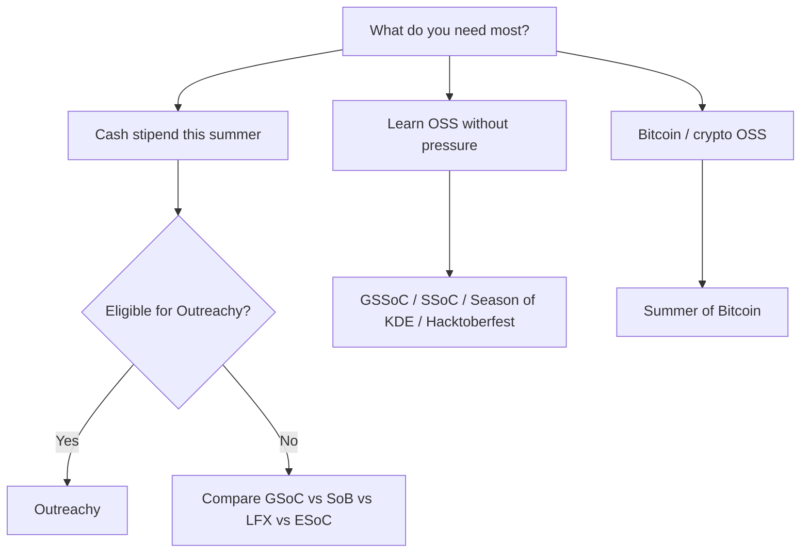

# Which program should I pick?

Pick **2–3 targets**, not ten. Use this map, then read the program page and official guide.

## Start here

## By goal

| Your goal | Strong fits |
| --- | --- |
| **Highest fixed stipend (US-style)** | [Outreachy](../programs/outreachy.md) |
| **Flexible global program, non-students OK** | [GSoC](../programs/google-summer-of-code.md) |
| **New to OSS worldwide** | [ESoC](../programs/european-summer-of-code.md) |
| **Bitcoin dev or design** | [Summer of Bitcoin](../programs/summer-of-bitcoin.md) |
| **Cloud / CNCF / kernel / LF ecosystem** | [LFX](../programs/lfx-mentorship.md) |
| **Technical writing** | [Season of Docs](../programs/google-season-of-docs.md) |
| **India gov-tech** | [C4GT](../programs/code-for-govtech.md) |
| **India science / simulation** | [FOSSEE](../programs/fossee-summer-fellowship.md), [eSim](../programs/esim-internship.md) |
| **Beginner certificate track** | [GSSoC](../programs/girlscript-summer-of-code.md), [SSoC](../programs/social-summer-of-code.md) |
| **Haskell / via GSoC org** | [Summer of Haskell](../programs/summer-of-haskell.md) |
| **Grant for a FOSS idea (EU)** | [NLnet](../programs/nlnet-foundation-grants.md) |

## By experience

| You are… | Suggested path |
| --- | --- |
| **Never opened a PR** | [first-contribution.md](first-contribution.md) → Hacktoberfest or GSSoC → then GSoC/ESoC |
| **Some PRs, no mentor relationship** | Pick one org, 2–3 merged PRs, then GSoC or LFX |
| **Strong systems / C** | Kernel mentorship, LFX, GSoC orgs (LLVM, etc.) |
| **Designer** | Summer of Bitcoin designer track, Outreachy UX projects |

## India-specific

See [india.md](india.md) for SIH, Devfolio, C4GT, FOSSEE, GSSoC, SSoC together.

## Compare side-by-side

[compare-programs.md](compare-programs.md)
